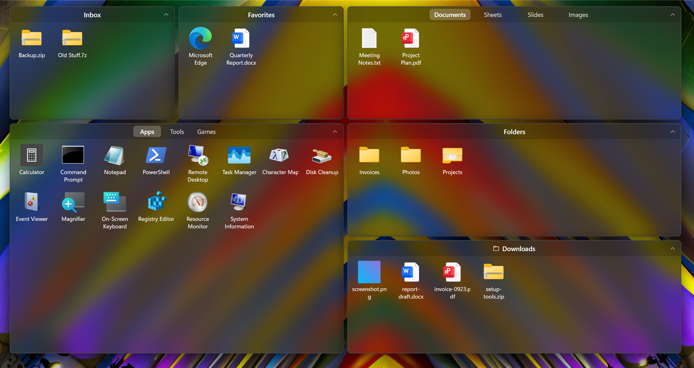

# SpringDesk

Organize your Windows 11 desktop into translucent boxes.

**Website: [springdesk.app](https://springdesk.app)** · [Microsoft Store](https://apps.microsoft.com/detail/9NRL4M710KQB?cid=github)

[中文说明](#中文说明)

## Features

- **Boxes**: create, rename, move and resize; the arrow on the title bar rolls a box up to just its title
- **Tabs**: several groups of icons in one box — drop a box onto another box's title bar to merge them
- **Folder boxes**: a box that shows a folder, such as Downloads
- **Sorted for you**: on first run your desktop is sorted by type into apps, files, folders and downloads; anything unclear goes to the Inbox. New files on the desktop find their place automatically
- **Desktop search**: click the desktop or a box and just type, or press Ctrl+Alt+Space anytime
- **Quick Look**: select an icon and press Space to see pictures, videos, music, text and PDFs without opening them; other files show their details. The arrow keys move to the next one
- **Light and dark**: follows Windows, or pick one in Settings → Appearance
- **Settings**: theme and opacity, the sorting box, layout lock, daily layout backups

In English, or in Chinese on Chinese Windows (Settings → General → Language).

## Install

1. Get SpringDesk from the [Microsoft Store](https://apps.microsoft.com/detail/9NRL4M710KQB?cid=github) (free 7-day trial).
2. SpringDesk opens and sorts your desktop. It starts with Windows from then on.

Had the free version from GitHub? Open the Store version once: your boxes come along, and it asks you to uninstall the GitHub copy.

Requires **Windows 11**. If another desktop organizer is running, quit it first.

## Updates

Automatic, through the Microsoft Store.

## Uninstall

Windows Settings → Apps → Installed apps → SpringDesk → Uninstall. Your files stay where they are, and Windows' own desktop icons come back.

## FAQ

**Does SpringDesk move my files?**
No. It only shows them in boxes; they stay in your Desktop folder. After uninstalling, your desktop is as it was.

**What is "Also show Windows’ own icons" in the tray menu?**
An emergency switch: if something goes wrong with the boxes, turn it on to see Windows' own desktop icons. It's also in Settings → General.

**My security software (360, Huorong…) shows a warning.**
Typing on the desktop to search needs to receive keystrokes, which some security software flags. Allow it, or turn the feature off in Settings → General.

**Something went wrong.**
Settings → About → Export diagnostics, and send me the zip. It holds logs and your layout, with file names but no file contents.

---

## 中文说明

Windows 11 桌面整理工具：把桌面上的图标放进一个个半透明的分区里。

### 能做什么

- **分区**：新建、改名、拖动、调整大小；标题栏右边的箭头可以把分区卷起来，只留标题栏
- **标签页**：一个分区里放几组图标；把一个分区拖到另一个分区的标题栏上，就合并成标签页
- **文件夹门户**：分区里直接显示某个文件夹（比如"下载"）的内容
- **自动整理**：第一次使用时按类型分好"软件 / 文件 / 文件夹 / 下载"，分不清的放进"临时分区"；以后桌面上的新文件也会自动归位
- **桌面搜索**：点一下桌面或分区后直接打字就能搜，中文打拼音，全拼或首字母都行（比如 weixin 或 wx 找到微信）；也可以随时按 Ctrl+Alt+空格
- **空格预览**：选中图标按空格，不用打开就能看图片、视频、音乐、文本和 PDF；其他文件显示信息。方向键看下一个
- **浅色和深色**：跟随 Windows，也可以在 设置 → 外观 里选
- **设置**：主题和不透明度、收纳门户、锁定分区、每天自动备份布局
- **中英文界面**：跟随 Windows 的显示语言，也可以在 设置 → 通用 → 语言 里改

### 安装

1. 到 [微软商店](https://apps.microsoft.com/detail/9NRL4M710KQB?cid=github) 安装 SpringDesk（可以免费试用 7 天）。
2. 装好后 SpringDesk 会自动打开，把桌面上的东西按类型整理好，以后开机自动启动。

以前装过 GitHub 上的免费版？打开一次商店版，分区会原样接过来，并提醒你卸载 GitHub 版。

需要 **Windows 11**。如果在用别的桌面整理工具，请先把它退出。

### 更新

自动的，由微软商店更新。

### 卸载

Windows 设置 → 应用 → 已安装的应用 → SpringDesk → 卸载。桌面上的文件不会动，Windows 自己的桌面图标会恢复显示。

### 常见问题

**桌面上的文件会被移走吗？**
不会。SpringDesk 只是把它们显示在分区里，文件一直在原来的桌面文件夹里。卸载后桌面和原来一样。

**想暂时用回 Windows 自带的桌面？**
右键托盘图标，取消勾选"启用 SpringDesk"（设置 → 通用 → 桌面 里也有）。桌面马上换回 Windows 自己的图标，SpringDesk 不退出，分区和布局都保留，再勾上就回来。

**安全软件（360、火绒等）弹出提示？**
"在桌面上打字就搜索"需要接收键盘输入，有的安全软件会提示，选择允许就行。不想用这个功能的话，可以在 设置 → 通用 里关掉。

**遇到问题怎么办？**
设置 → 关于 → 导出诊断信息，把生成的压缩包发给我。里面是日志和分区布局，有桌面上的文件名，没有文件内容。

### 更新日志

见 [商店页](https://apps.microsoft.com/detail/9NRL4M710KQB?cid=github) 的"此版本中的新增功能"。
